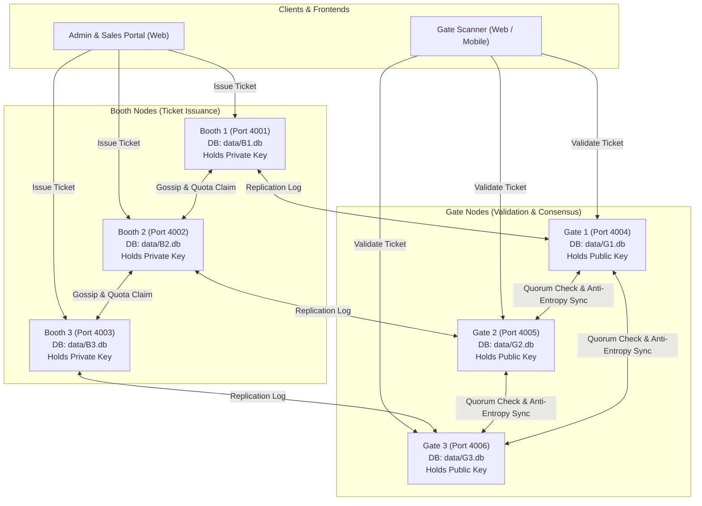

# FestPass Project Context & System Architecture

## 1. Project Goal

FestPass is a Distributed Campus Event Ticketing and Entry Validation system built for high-throughput, fault-tolerant university campus festivals.

Tickets are sold from multiple physical **BOOTH** nodes (`B1`, `B2`, `B3`) and validated at multiple physical **GATE** nodes (`G1`, `G2`, `G3`). The core technical mission of FestPass is solving the distributed double-spend and concurrent entry problem:

- Prevent overselling when booths operate semi-independently.
- Ensure a single ticket cannot be scanned at two entry gates simultaneously.
- Support **offline gate validation** during temporary campus Wi-Fi network dropouts.
- Provide deterministic **conflict resolution** when gates reconnect and synchronize their offline operations.
- Implement distributed systems fundamentals: state-machine replication, 64-bit unique ID generation, causal event ordering (Hybrid Logical Clocks), asymmetric cryptographic token verification (Ed25519), failure detection, and quorum consensus.

---

## 2. System Architecture

### 2.1 Topology & Role Distribution

The system runs 6 autonomous server processes on different ports, sharing the same codebase but retaining isolated SQLite database files in `data/<NODE_ID>.db`:

| Node ID | Role    | Port | Primary Responsibility                                                            |
| ------- | ------- | ---- | --------------------------------------------------------------------------------- |
| `B1`    | `booth` | 4001 | Sells tickets, holds Ed25519 private key, manages partitioned quota slice         |
| `B2`    | `booth` | 4002 | Sells tickets, holds Ed25519 private key, manages partitioned quota slice         |
| `B3`    | `booth` | 4003 | Sells tickets, holds Ed25519 private key, manages partitioned quota slice         |
| `G1`    | `gate`  | 4004 | Scans tickets, verifies Ed25519 signature offline, participates in quorum checkin |
| `G2`    | `gate`  | 4005 | Scans tickets, verifies Ed25519 signature offline, participates in quorum checkin |
| `G3`    | `gate`  | 4006 | Scans tickets, verifies Ed25519 signature offline, participates in quorum checkin |

### 2.2 Architecture Diagram



---

## 3. Tech Stack & Hard Rules

### 3.1 Strict Rules

1. **JavaScript Only**: Node.js 20+, CommonJS on the server (`type: "commonjs"`), React 18 (JSX) on the frontend. **NO TypeScript, NO Java, NO Python**.
2. **Monorepo Structure**: Uses standard `npm workspaces`: `packages/shared`, `apps/server`, `apps/web`.
3. **Storage Isolation**: One SQLite file per node (`data/<NODE_ID>.db`) to faithfully simulate independent machines.
4. **Local Execution**: All nodes run locally on separate ports without requiring Docker or cloud services.
5. **Quality Guarantee**: Every stage must leave the repository in a fully working state (`npm install`, linting, and all unit/integration tests must pass).

### 3.2 Stack Breakdown

- **Server**: Express 4, `better-sqlite3`, `zod`, `pino`, `pino-pretty`, `dotenv`, `cors`, `helmet`, `express-rate-limit`, `jsonwebtoken`, `bcryptjs`, `socket.io`, `undici`.
- **Testing**: `vitest` + `supertest`.
- **Frontend**: React 18, Vite, React Router, Tailwind CSS, Framer Motion, Axios, Zustand, React Hot Toast, `qrcode.react`, `html5-qrcode`, Recharts, Lucide React, Socket.IO Client.

---

## 4. Folder Structure & File Purpose

```
FestPass/
├── .env.example                               # Canonical template for environment variables
├── .gitignore                                 # Git ignore patterns (node_modules, data/, keys/, .env)
├── .prettierrc                                # Code formatting rules
├── eslint.config.js                           # Flat ESLint 9 configuration for CJS server & React JSX
├── package.json                               # Monorepo root package definition and cluster scripts
├── vitest.workspace.js                        # Multi-project test workspace config for Vitest
├── CONTEXT.md                                 # Quick entry banner and mandatory rule directive
├── README.md                                  # Setup and operational instructions
├── docs/
│   ├── API_CONTRACT.md                        # Complete API and wire protocol specifications
│   └── PROJECT_CONTEXT.md                     # Architecture, design decisions, and stage status
├── scripts/
│   ├── keygen.js                              # Ed25519 keypair generator script
│   └── seed.js                                # Database seed runner (Stage 2 stub)
├── packages/
│   └── shared/                                # Common library shared across server and frontend
│       ├── package.json                       # Shared package manifest
│       ├── src/
│       │   ├── index.js                       # Barrel export for constants, snowflake, hlc, tokens, schemas
│       │   ├── constants.js                   # Enums for roles, statuses, errors, socket events
│       │   ├── snowflake.js                   # 64-bit BigInt Snowflake unique ID generator
│       │   ├── hlc.js                         # Hybrid Logical Clock with drift check and tie-breaking
│       │   ├── tokens.js                      # Ed25519 ticket signing and verification helpers
│       │   └── schemas.js                     # Zod validation schemas for all contract payloads
│       └── test/
│           ├── snowflake.test.js              # Unit tests for ID monotonicity and collision resistance
│           ├── hlc.test.js                    # Unit tests for causal ordering and drift rejection
│           └── tokens.test.js                 # Unit tests for Ed25519 signature validity and tampering
└── apps/
    ├── server/                                # Express server supporting booth and gate roles
    │   ├── package.json                       # Server manifest and dependencies
    │   ├── src/
    │   │   ├── server.js                      # Process entry point, HTTP listener, graceful shutdown
    │   │   ├── app.js                         # Express setup, middleware stack, route mounting
    │   │   ├── config/
    │   │   │   └── index.js                   # Zod-validated environment config loader
    │   │   ├── logger/
    │   │   │   └── index.js                   # Pino logger with node identity and pretty printing
    │   │   ├── db/
    │   │   │   ├── index.js                   # SQLite connection factory (WAL, foreign keys, busy timeout)
    │   │   │   ├── migrator.js                # Migration runner reading SQL migrations
    │   │   │   └── migrations/
    │   │   │       └── 001_initial_schema.sql # All 9 relational tables required across all stages
    │   │   ├── middleware/
    │   │   │   ├── requestId.js               # Injects/propagates X-Request-Id and child logger
    │   │   │   ├── errorHandler.js            # Standardized JSON error response handler
    │   │   │   └── auth.js                    # JWT extraction and role-based access middleware (Stage 2)
    │   │   ├── routes/
    │   │   │   ├── health.js                  # /health and /node/info implementations
    │   │   │   ├── auth.js                    # Authentication route stubs (Stage 2)
    │   │   │   ├── events.js                  # Events CRUD route stubs (Stage 2)
    │   │   │   ├── tickets.js                 # Ticket issuance and lookup route stubs (Stage 2)
    │   │   │   ├── gate.js                    # Gate scanning and offline batch stubs (Stage 4)
    │   │   │   ├── cluster.js                 # Cluster status and conflict query stubs (Stage 3 & 4)
    │   │   │   └── internal.js                # Internal peer gossip, sync, claim, and chaos stubs (Stage 3 & 4)
    │   │   ├── services/
    │   │   │   ├── idService.js               # Node-level Snowflake generator singleton
    │   │   │   ├── hlcService.js              # Node-level Hybrid Logical Clock singleton
    │   │   │   ├── tokenService.js            # Key loader and ticket signing/verification service
    │   │   │   ├── ticketService.js           # Ticket logic service stub (Stage 2)
    │   │   │   ├── gateService.js             # Gate validation logic service stub (Stage 4)
    │   │   │   └── replicationService.js      # Gossip and replication logic service stub (Stage 3)
    │   │   └── socket/
    │   │       └── index.js                   # Socket.IO initialization and broadcast helpers
    │   └── test/
    │       ├── health.test.js                 # Integration tests for health and metadata endpoints
    │       └── db.test.js                     # Integration tests for SQLite schema and constraints
    └── web/                                   # Frontend web application scaffold
        ├── package.json                       # Web manifest and frontend dependencies
        ├── vite.config.js                     # Vite build configuration
        ├── tailwind.config.js                 # Tailwind CSS configuration
        ├── postcss.config.js                  # PostCSS plugins (Tailwind, Autoprefixer)
        ├── index.html                         # SPA HTML entry point
        └── src/
            ├── index.css                      # Tailwind base and custom theme styling
            ├── main.jsx                       # React DOM mount point
            └── App.jsx                        # Stage 1 placeholder dashboard and architecture viewer
```

---

## 5. Environment Variables

| Variable              | Type         | Default        | Description                                                     |
| --------------------- | ------------ | -------------- | --------------------------------------------------------------- |
| `PORT`                | Number       | `4001`         | HTTP listening port (4001-4003 for booths, 4004-4006 for gates) |
| `NODE_ID`             | String       | `B1`           | Node identifier (`B1`..`B3`, `G1`..`G3`)                        |
| `NODE_ROLE`           | String       | `booth`        | Role: `booth`, `gate`, or `both`                                |
| `NODE_INDEX`          | Number       | Deduce from ID | 10-bit integer (1..6) for Snowflake ID uniqueness               |
| `DATA_DIR`            | String       | `./data`       | Directory where per-node SQLite databases are stored            |
| `JWT_SECRET`          | String       | Dev Secret     | Secret string used to sign and verify user JWTs                 |
| `LOG_LEVEL`           | String       | `info`         | Pino log level (`trace`, `debug`, `info`, `warn`, `error`)      |
| `ED25519_PRIVATE_KEY` | String (PEM) | Optional       | Private key for signing ticket tokens (Booth nodes)             |
| `ED25519_PUBLIC_KEY`  | String (PEM) | Required       | Public key for verifying ticket tokens (All nodes)              |
| `PEERS`               | String       | 6 nodes        | Comma-separated `NODE_ID=URL` cluster topology mappings         |

---

## 6. How to Run Everything

### 6.1 Installation & Key Generation

```bash
# 1. Install all dependencies across workspaces
npm install

# 2. Generate Ed25519 keypair and initialize .env
npm run keygen
```

### 6.2 Running the Full 6-Node Cluster

```bash
# Starts B1, B2, B3, G1, G2, G3 concurrently with colorized logs
npm run cluster
```

### 6.3 Running Individual Nodes

```bash
npm run node:b1   # Starts Booth 1 on port 4001
npm run node:b2   # Starts Booth 2 on port 4002
npm run node:b3   # Starts Booth 3 on port 4003
npm run node:g1   # Starts Gate 1 on port 4004
npm run node:g2   # Starts Gate 2 on port 4005
npm run node:g3   # Starts Gate 3 on port 4006
```

### 6.4 Running Tests and Linting

```bash
npm run test         # Executes Vitest suite across packages and server
npm run lint         # Runs ESLint checks
npm run format:check # Verifies Prettier code formatting
npm run format       # Auto-formats all codebase files
```

### 6.5 Running Frontend Development Server

```bash
npm run dev -w apps/web  # Starts Vite frontend on http://localhost:3000
```

---

## 7. Data Model (SQLite Schema)

All tables are created in Stage 1 in `apps/server/src/db/migrations/001_initial_schema.sql` so subsequent stages only implement business logic without schema adjustments:

1. `users`: System staff and administrators (`id`, `name`, `email`, `password_hash`, `role`, `created_at`).
2. `events`: Fest events (`id`, `name`, `venue`, `starts_at`, `capacity`, `price`, `status`, `created_at`).
3. `booth_quotas`: Partitioned quota allocations for booth oversell prevention (`event_id`, `node_id`, `quota`, `sold`). Primary key: `(event_id, node_id)`.
4. `tickets`: Issued tickets (`id`, `event_id`, `holder_name`, `holder_email`, `holder_phone`, `issued_by_node`, `issued_at_hlc`, `status`, `token`, `created_at`).
5. `checkins`: Entry attempts at gate nodes (`id`, `ticket_id`, `gate_node_id`, `hlc`, `mode`, `result`, `resolved`, `created_at`).
6. `op_log`: State-machine replication log for anti-entropy sync (`op_id`, `origin_node`, `hlc`, `type`, `payload_json`, `applied_at`).
7. `peers`: Gossip membership and heartbeat registry (`node_id`, `url`, `role`, `last_seen`, `status`).
8. `conflicts`: Logs of concurrent checkin attempts detected during sync (`id`, `ticket_id`, `winner_checkin_id`, `loser_checkin_id`, `detected_at`, `details_json`).
9. `meta`: Key-value configuration and local replication watermark storage (`key`, `value`).

---

## 8. Core Distributed Systems Design Decisions

### 8.1 64-Bit Snowflake Unique IDs

- **Why**: Traditional auto-incrementing integer IDs require centralized coordination. Random UUIDv4 strings are 128-bit, lack index locality, and cannot be sorted chronologically.
- **Layout**: 1 bit sign (0) + 41 bits millisecond timestamp since epoch (~69 years) + 10 bits node index (up to 1,024 nodes) + 12 bits sequence (4,096 IDs per ms per node).
- **Failure Handling**:
  - **Clock Skew / Backward Drift**: If `timestamp < lastTimestamp`, small drift (≤ 1000ms) pauses and spins until clock catches up; large drift throws `ClockMovedBackwardsError`.
  - **Sequence Exhaustion**: If 4,096 IDs are generated within the exact same millisecond, the generator spins until the next physical millisecond.

### 8.2 Hybrid Logical Clock (HLC)

- **Why**: Physical clocks (`Date.now()`) on different machines suffer from NTP jitter and arbitrary backward corrections, making them unreliable for causal event ordering. Pure Lamport logical clocks lose connection to physical wall-clock time. HLC combines physical time bounds with logical monotonicity.
- **Ordering Guarantee**: Total ordering defined as:
  1. `wallTime` ascending
  2. `logical` counter ascending
  3. `nodeId` lexicographical tie-break (e.g. `'B1' < 'B2'`)
- **Offline Drift Protection**: Reject incoming messages if remote wall-time drifts more than `maxDriftMs` (default 60 seconds).

### 8.3 Asymmetric Ticket Tokens (Ed25519)

- **Why**: Gates must validate tickets during Wi-Fi outages without communicating with the central database or booths. Symmetric HMAC requires sharing the secret key with all gates, allowing a compromised gate to forge tickets.
- **Asymmetric Solution**:
  - **Booth Nodes** hold the Ed25519 **Private Key** and digitally sign `FP1.<ticketId>.<eventId>`.
  - **Gate Nodes** hold only the Ed25519 **Public Key**. Gate nodes can verify ticket authenticity and integrity 100% offline, but cannot mathematically forge or issue tickets.

---

## 9. Stage Ownership & Status

| Stage       | Focus Area                   | Primary Deliverables                                                  | Owner    | Status   |
| ----------- | ---------------------------- | --------------------------------------------------------------------- | -------- | -------- |
| **Stage 1** | Foundation & Core Primitives | Shared package, DB schema, config, HLC, Snowflake, Ed25519, contracts | Member 1 | **DONE** |
| **Stage 2** | Auth, Events & Booth Sales   | JWT auth, events CRUD, booth ticket sales, quota oversell prevention  | Member 2 | PENDING  |
| **Stage 3** | Replication & Membership     | Peer gossip, heartbeat failure detector, anti-entropy log sync        | Member 3 | PENDING  |
| **Stage 4** | Gate Validation & Quorum     | Offline validation, quorum checkin, concurrent double-scan resolution | Member 4 | PENDING  |
| **Stage 5** | Admin & Booth Frontend       | React admin dashboard, booth sales UI, ticket view with failover      | Member 5 | PENDING  |
| **Stage 6** | Scanner UI, Chaos & Testing  | Gate QR scanner, live cluster dashboard, chaos tools, load tests      | Member 6 | PENDING  |

---

## 10. Coding Conventions & Standards

- **File & Module Conventions**: CommonJS on the server (`require` / `module.exports`), ES Modules on the frontend.
- **Symbol Naming**:
  - Functions & variables: `camelCase`
  - Classes & components: `PascalCase`
  - Constants & Enums: `UPPER_SNAKE_CASE`
- **Error Formatting**: Always throw `AppError` or use the global error handler. All responses follow `{ success: false, error: { code, message, details } }`.
- **Logging**: Never use raw `console.log` in server code. Always use `req.log` or the node `logger` instance (`logger.info`, `logger.warn`, `logger.error`), which automatically binds `nodeId`, `role`, and `reqId`.

---

## 11. Git Workflow & Stage Boundaries

1. Every stage member creates a dedicated branch: `stage-<N>-<feature-name>` (e.g., `stage-2-booth-sales`).
2. Make small, logical, conventional commits:
   - `feat: ...`
   - `fix: ...`
   - `chore: ...`
   - `docs: ...`
   - `test: ...`
3. **Stage Boundary Rule**: Do NOT modify files owned by another stage unless resolving a minimal, documented bug or integration blocker.
4. Before submitting PR to `main`:
   - `npm run test` must pass (all tests green).
   - `npm run lint` must pass (0 errors).
   - `npm run format:check` must pass.
   - Update `docs/PROJECT_CONTEXT.md` stage status.

---

## 12. Stage 1 Completion Report

### 12.1 Built in Stage 1

- **Monorepo Architecture**: Configured npm workspaces (`packages/shared`, `apps/server`, `apps/web`) with cross-platform npm scripts and Vitest test runner.
- **Shared Primitives (`@festpass/shared`)**:
  - `SnowflakeGenerator`: 64-bit BigInt unique ID generator with backward drift and sequence overflow handling.
  - `HLC`: Hybrid Logical Clock with monotonic logical increments, drift bounds, and total ordering tie-breaking.
  - `tokens`: Ed25519 key generation, ticket signing (`FP1.<ticketId>.<eventId>.<sig>`), and offline public key verification.
  - `constants` & `schemas`: Centralized enums and Zod validation schemas for all contract payloads.
  - 100% test coverage for all shared primitives (21 unit tests).
- **Server Foundation (`@festpass/server`)**:
  - Zod-validated environment config loader with role detection.
  - Pino structured logger with node context (`nodeId`, `role`).
  - SQLite database manager (`better-sqlite3` 12.11.1) with WAL mode, foreign keys, and migration runner.
  - Schema migration creating all 9 required relational tables (`users`, `events`, `booth_quotas`, `tickets`, `checkins`, `op_log`, `peers`, `conflicts`, `meta`).
  - Middleware stack: `requestId`, `errorHandler`, `auth` (stub).
  - Routes implemented: `GET /health` and `GET /node/info`.
  - Clearly marked route and service stubs (`// TODO(stage-2)`, `// TODO(stage-3)`, `// TODO(stage-4)`).
  - Socket.IO server initialization and event broadcast helpers.
- **Frontend Scaffold (`@festpass/web`)**:
  - React 18 + Vite + Tailwind CSS + Framer Motion.
  - Modern dark-mode architecture dashboard displaying cluster nodes, primitives, and 6-stage roadmap.
- **Scripts**:
  - `npm run keygen`: Generates Ed25519 keys, saves to `keys/`, and initializes `.env`.
  - `npm run cluster`: Concurrently runs all 6 nodes (`B1`..`G3`) on ports 4001..4006.
  - `npm run seed`: Stub script for Stage 2 database seeding.
- **Context & Documentation**:
  - `CONTEXT.md` rule directive.
  - `docs/API_CONTRACT.md` detailing every endpoint across all stages.
  - `docs/PROJECT_CONTEXT.md` comprehensive project blueprint.

### 12.2 Stubs for Subsequent Stages

- `apps/server/src/routes/auth.js` -> Auth endpoints (`// TODO(stage-2)`)
- `apps/server/src/routes/events.js` -> Events endpoints (`// TODO(stage-2)`)
- `apps/server/src/routes/tickets.js` -> Ticket sale endpoints (`// TODO(stage-2)`)
- `apps/server/src/routes/cluster.js` -> Peer and replication endpoints (`// TODO(stage-3)`)
- `apps/server/src/routes/internal.js` -> Gossip, sync, and claim endpoints (`// TODO(stage-3)`)
- `apps/server/src/routes/gate.js` -> Gate scan and batch replay endpoints (`// TODO(stage-4)`)
- `scripts/seed.js` -> Database seeding script (`// TODO(stage-2)`)

### 12.3 Known Issues / Notes

- On Windows systems with strict local firewall policies, ephemeral TCP port binding in tests requires unrestricted local loopback permission (addressed via Vitest configuration).
- `better-sqlite3` 12.11.1 provides prebuilt native binaries for Node.js 24 on Windows x64, avoiding the requirement for Visual Studio C++ build tools.

### 12.4 Handoff Notes for Stage 2 (Member 2)

1. **Database Schema**: All tables (`users`, `events`, `booth_quotas`, `tickets`) are already created in `data/<NODE_ID>.db`. Do not edit the migration file; your schema is ready to query.
2. **Key Files for Stage 2**:
   - `apps/server/src/routes/auth.js` & `apps/server/src/middleware/auth.js`: Implement bcrypt password hashing (`bcryptjs`) and JWT token signing (`jsonwebtoken`).
   - `apps/server/src/routes/events.js`: Implement event creation and divide event capacity into `booth_quotas` across `B1`, `B2`, `B3`.
   - `apps/server/src/routes/tickets.js` & `apps/server/src/services/ticketService.js`: Sells tickets. In an atomic SQLite transaction:
     - Check `booth_quotas.sold < booth_quotas.quota` on the local node.
     - Increment `booth_quotas.sold`.
     - Generate ticket ID via `idService.generateId()`.
     - Advance clock via `hlcService.send()`.
     - Sign ticket token via `tokenService.sign(ticketId, eventId)`.
     - Insert row into `tickets`.
     - Insert `TICKET_ISSUED` into `op_log`.
     - Emit WebSocket event via `broadcastTicketIssued(ticket)`.
3. **Seed Script**: Populate `scripts/seed.js` with initial admin and staff credentials and sample fest events.
